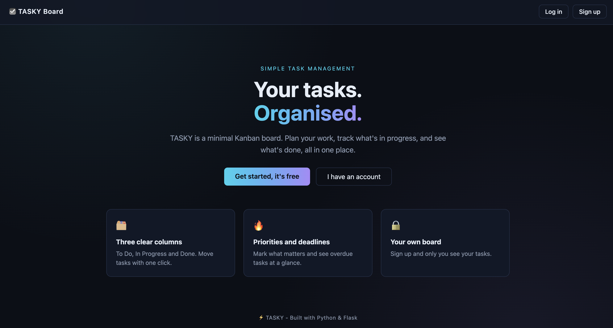
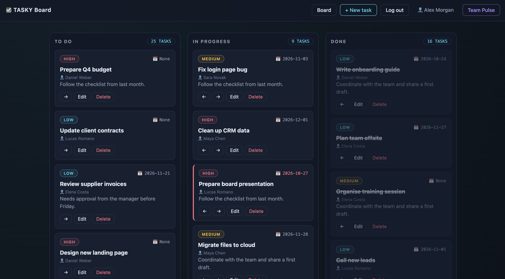
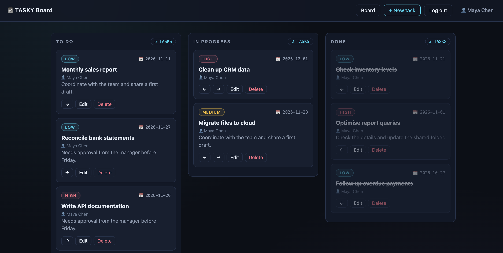
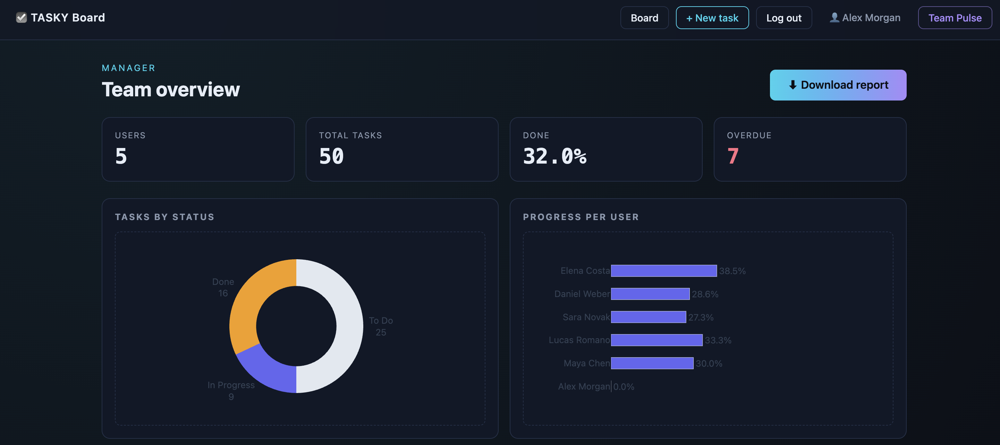
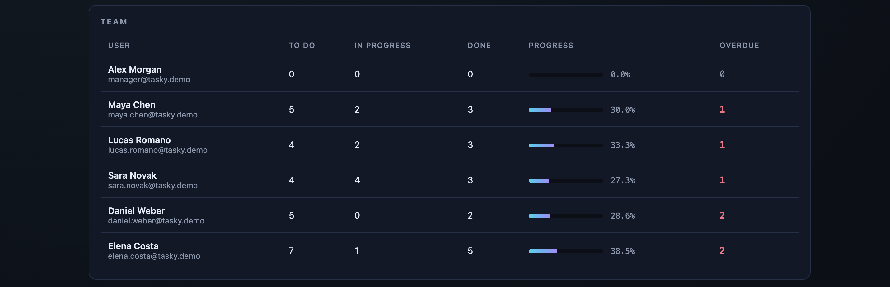
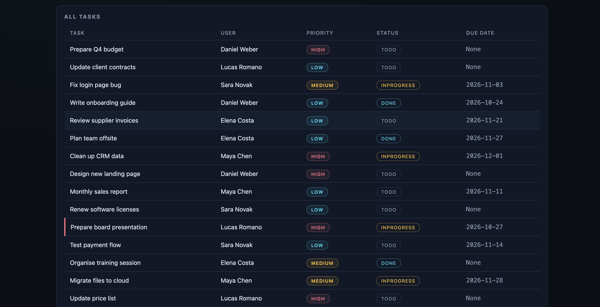
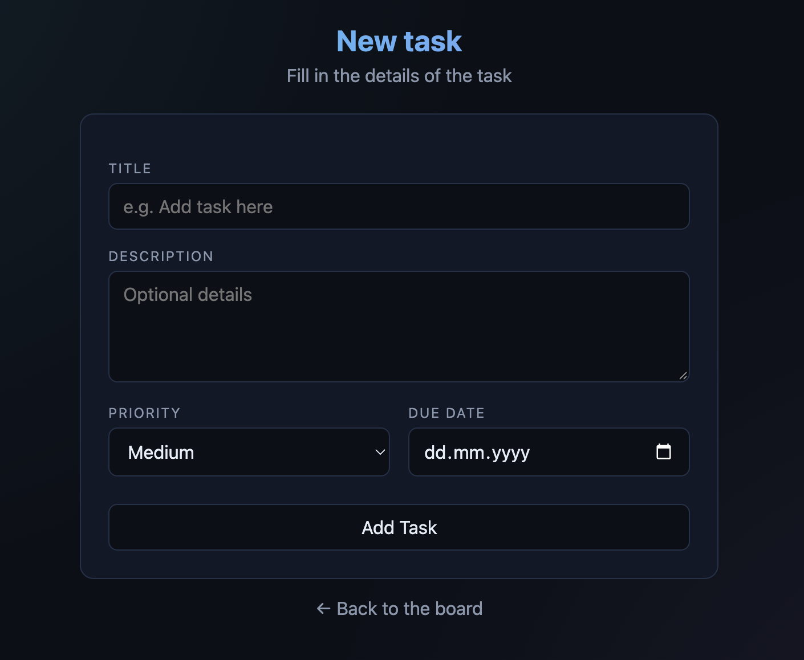
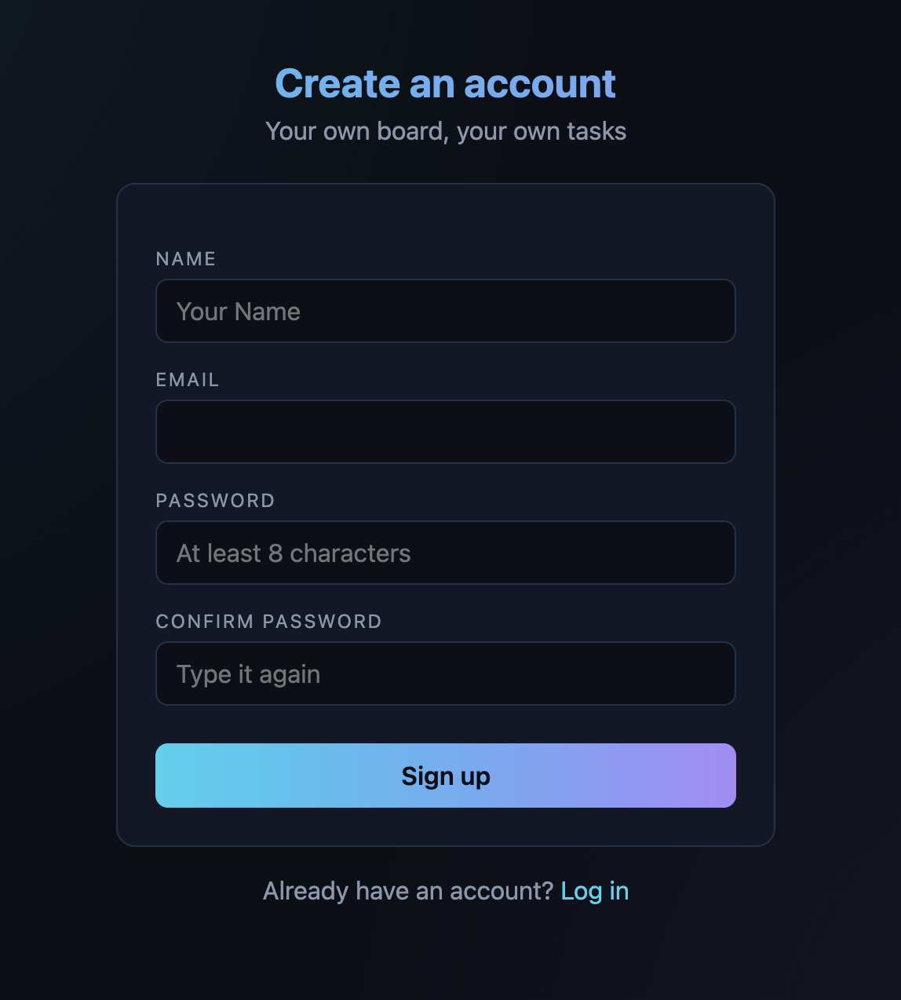
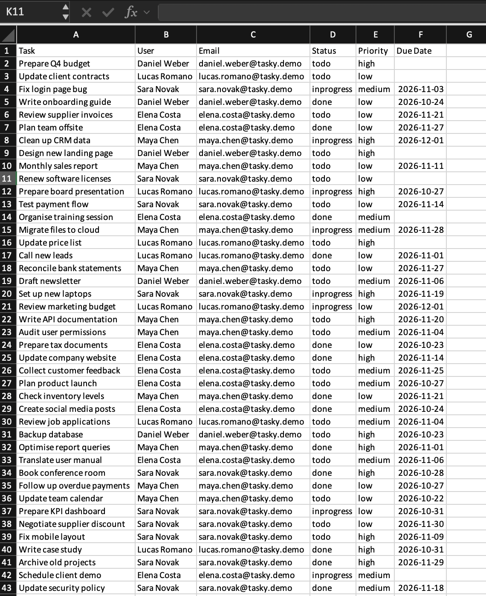

# ☑️ TASKY

A minimal Kanban task board built with **Python & Flask**.
Plan your work, move tasks between **To Do → In Progress → Done**, and give managers a live overview of the whole team.



## ✨ Features

**For everyone**
- 🔐 Sign up and log in (hashed passwords, Flask-Login)
- 🗂️ Kanban board with three columns, move tasks with one click
- 🔥 Priorities (low / medium / high) and due dates
- ⏰ Overdue tasks highlighted in red
- 🔒 Users only see and change their own tasks

**For managers: Team Pulse**
- 📈 Stat cards: users, total tasks, % done, overdue
- 🍩 Charts: tasks by status and progress per user (Plotly)
- 👥 Team table with each user's progress bar
- 📋 Table of all tasks across the team
- ⬇️ One-click export of every task to Excel (pandas)

## 📸 Screenshots

### Board (manager view: everyone's tasks)


### Board (user view: only your own tasks)


### Team Pulse: stats and charts


### Team Pulse: team progress


### Team Pulse: all tasks


### New task and sign up
<p>
  
  
</p>

### Excel export


## 🛠️ Tech stack

| Part | Tools |
|---|---|
| Backend | Python, Flask |
| Database | SQLite, Flask-SQLAlchemy |
| Auth & forms | Flask-Login, Flask-WTF, Werkzeug password hashing |
| Data & charts | pandas, Plotly, openpyxl |
| Frontend | HTML, CSS, Jinja templates |

## 🚀 Run it locally

```bash
git clone https://github.com/<your-username>/tasky-to-do-list.git
cd tasky-to-do-list

python3 -m venv .venv
source .venv/bin/activate          # Windows: .venv\Scripts\activate
python3 -m pip install -r requirements.txt
```

Create a `.env` file in the project folder:

```
SECRET_KEY=any-long-random-text
DB_URI=sqlite:///tasky.db
```

Then:

```bash
python3 seed.py   # optional: fill the app with demo users and tasks
python3 app.py
```

Open http://127.0.0.1:5000

### 🔑 Demo accounts (after running `seed.py`)

| Role | Email | Password |
|---|---|---|
| Manager | manager@tasky.demo | password123 |
| User | maya.chen@tasky.demo | password123 |

## 📁 Project structure

```
tasky-to-do-list/
├── app.py            # models, forms and routes
├── stats.py          # build_stats(): counts, overdue, completion %
├── charts.py         # Plotly charts for Team Pulse
├── seed.py           # demo users and tasks
├── requirements.txt
├── templates/        # HTML pages (Jinja)
├── static/css/       # styles
└── screenshots/      # images for this README
```

## 🔌 API

`GET /api/tasks` returns tasks as JSON.

Send your key in the header: `x-api-key: <API_KEY from .env>`

Optional filters: `status`, `priority`, `user_id`

```
/api/tasks?status=todo&priority=high
/api/tasks?user_id=2
```

| Response | Meaning |
|---|---|
| 200 | List of tasks |
| 401 | Missing or wrong API key |
| 404 | No tasks match the filters |

## 👤 Author

Built by **Louis Qarri** as a personal project.
